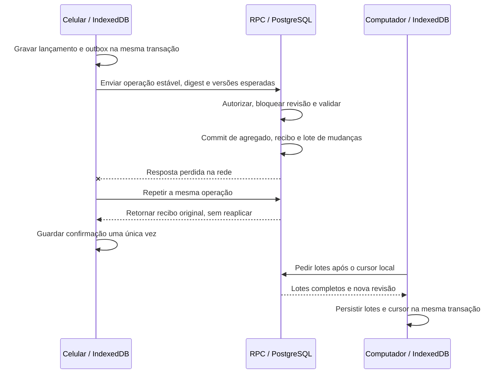

# Incremento 3 — plano aprovado com limites

Data: 26/10/2026. **Plano aprovado posteriormente pelo usuário para implementação local, migrações versionadas, testes e checkpoints. Provisionamento, OAuth, SQL remoto, publicação, faturamento/trials, piloto real e I4 continuam sem autorização.**

## Aprovação posterior e leitura deste plano

O texto abaixo da seção 1 preserva o planejamento original e seus critérios. Afirmações de “nesta tarefa”, “ausência dos originais” e “aguardar aprovação” descrevem a etapa de planejamento, não o estado atual. A evidência atual está em [EXECUCAO_INCREMENTO_3.md](EXECUCAO_INCREMENTO_3.md), [ESTADO_ATUAL.md](ESTADO_ATUAL.md) e [VALIDACAO.md](VALIDACAO.md).

Limites e decisões efetivamente aprovados:

- Recuperação mínima de uma exportação I2 em origem/dispositivo novo, preservando IDs, centavos, histórico e pendências, validada antes de gravar e sem alterações parciais ou duplicação. Não implementar restauração completa de I4. Comprovar com dados sintéticos antes de piloto real. Esta autorização substitui a exclusão de importação mínima descrita nas seções 4 e 8; substituição/gerações continuam excluídas.
- Após autenticação e associação inicial online, consulta e registro offline. Expiração preserva dados e pendências, bloqueando transmissão até nova autenticação. Logout explícito bloqueia visão local até reautenticar e preserva pendências. Sem promessa de sincronização com app fechado ou criptografia local.
- Localizar os originais privados nas fontes autorizadas antes de regras dependentes. Os quatro foram encontrados e lidos no Drive; cópias ficam ignoradas, nunca no Git. Igualdade com o antigo manifesto de hashes continua não verificada.
- Inventário informado pelo usuário: nenhum uso pessoal ou dado financeiro próprio; somente testes sintéticos da VM. Não promover teste a base inaugural nem associar/mesclar automaticamente. Orientação de primeiro uso será passo a passo.
- Implementação local de I3 em branch própria e checkpoints GitHub autorizados. Qualquer criação/configuração remota, OAuth, aplicação remota, publicação e piloto exigem autorização específica; nunca habilitar pagamento/trial.
- Separar implementação local, simulações e integração real. I3 só termina após Google restrito, isolamento e sincronização comprovados nos dois aparelhos. I4 não inicia automaticamente.

## 1. Base conferida e limites desta entrega

Foi conferida a branch `codex/incremento-2-local-finance`, inicialmente limpa, em `86bcdffebedaa09698a613c8f24e4bd7fa6ede6d`. `git fetch origin` e `git ls-remote` confirmaram o mesmo SHA no GitHub, incluindo código, testes e documentação finais de I2. Não houve reset, merge, troca de branch ou descarte de alterações.

Foram lidos integralmente `AGENTS.md`, README e os documentos existentes de plano aprovado, arquitetura, modelo, regras financeiras, segurança/RPC, sincronização, backup, custos, referências, roadmap, UI, estado atual, validação e próxima etapa. Também foram inspecionados identidade local, modelos, adaptador Dexie, payload da outbox, dependências e SQL de referência.

`PROMPT_CODEX.md`, `REQUISITOS_ATLAS.md`, `00_COMECE_AQUI.md` e o manifesto privado dos originais **não existem nesta VM**. Não foi possível lê-los ou conferir seus hashes. Este plano usa os contratos sanitizados disponíveis e o pedido atual; não reconstrói os originais nem inclui dados pessoais no Git. Antes de implementar, qualquer requisito privado adicional deverá ser conferido privadamente pelo usuário.

Nesta tarefa somente documentos são alterados. Não foram consultados projetos/contas reais, configurados provedores, instaladas dependências, criados serviços, executadas migrações ou implementadas funções de I3. A pesquisa oficial está em [REFERENCIAS_INCREMENTO_3.md](REFERENCIAS_INCREMENTO_3.md); decisões do usuário, em [PENDENCIAS_INCREMENTO_3.md](PENDENCIAS_INCREMENTO_3.md).

## 2. Objetivo e reaproveitamento

I3 deverá conectar celular e computador ao mesmo proprietário autorizado, mantendo a leitura local e o trabalho offline. Sucesso significa os mesmos registros, centavos, relações e histórico nos dois dispositivos após reconexão, com identificação inequívoca das pendências e sem expor outra conta.

| Parte atual | Aproveitar | Mudança proposta em I3 |
|---|---|---|
| React/TypeScript/Vite e telas I2 | Layout, formulários, navegação e comportamento financeiro. | Telas pequenas de acesso, associação, situação de envio e conflito; sem redesenho ou módulos financeiros novos. |
| Domínio puro | `bigint`, BRL, datas `America/Fortaleza`, validações, cálculos, estorno e substituição imutáveis. | Contratos versionados e validação equivalente no servidor; diferenças bloqueiam a liberação. |
| Comandos financeiros | IDs estáveis e agregado composto. | Envelope de protocolo, dependências, versões esperadas e vínculo ao proprietário autenticado. |
| Dexie/IndexedDB | Transações e isolamento por namespace. | Migração local aditiva; base remota confirmada, operações pendentes/conflitos e metadados de sincronização separados. |
| Outbox | ID, tipo, payload e persistência atômica com o lançamento. | Estados de entrega, digest, protocolo, tentativa, dependências e recibos; conteúdo congelado depois do primeiro envio. |
| Identidade local | Base anônima atual preservada como origem. | `auth.uid()` como proprietário remoto; associação explícita, sem tratar o UUID local como login. |
| Exportação JSON | Cópia independente com histórico e pendências. | Versão nova para recibos, vínculo de origem, cursor e conflitos; leitura compatível documentada. Não exportar sessões. |
| PWA | Shell versionado e atualização que espera fechar abas. | Cache restrito a estáticos; nenhuma resposta autenticada, token ou callback sensível em cache. Testar atualização de schema com pendências. |
| SQL I1 | Referência de entidades e invariantes. | Criar migrações próprias e testadas; `database/modelo_inicial.sql` continua intocado como referência, não será aplicado como backend pronto. |
| Testes | Evidências e cenários I1/I2. | Integração PostgreSQL/Auth/API real, dois usuários de teste isolados, dois clientes e falhas injetadas. |

Não entram cartões, recorrências, anexos/Storage, IA, Open Finance, pagamentos, notificações externas ou restauração completa. Supabase Realtime não é necessário à primeira versão do protocolo.

O runtime atual de `useLocalFinance` é uma instância local única inicializada pelo UUID anônimo. Ele precisará ser selecionado por proprietário/contexto autenticado, fechar handles e invalidar assinaturas/resultados antigos na troca de identidade. Não basta trocar uma variável de email ou reutilizar a instância anterior. Uma resposta em andamento continua pertencendo ao namespace de origem e nunca deve abrir dados na sessão seguinte.

## 3. Identidade: primeiro Google login e acesso restrito

### 3.1 Configuração futura, somente após autorização

1. Usar Supabase Auth com provedor Google comum; não confundir com SAML/SSO empresarial ou com o Supabase OAuth Server, que não são necessários.
2. O usuário informa a conta Google autorizada **em canal/configuração privada**. Não inferir esse email pelo nome do GitHub e não o versionar.
3. Um administrador pré-provisiona um único usuário com email confirmado, sem senha própria ou convite por SMTP, e registra seu UUID em `app_access` com acesso ativo. Nenhuma chave administrativa vai para o aplicativo.
4. Desabilitar novos cadastros, login anônimo, email/senha, OTP e provedores adicionais. Manter vinculação manual de identidades desabilitada. Conferir as configurações reais, sem presumir defaults.
5. No Google Auth Platform, preparar cliente Web e somente os escopos básicos `openid`, email e perfil. Não solicitar Gmail, Drive, contatos ou refresh token de APIs Google. A sessão do aplicativo é administrada pelo Supabase.
6. Cadastrar o callback exato do Supabase no cliente Google e os retornos exatos do aplicativo na allowlist Supabase. Google → Supabase e Supabase → aplicativo são dois retornos diferentes. Origem local, porta, esquema e caminho devem corresponder ao navegador que inicia o login. Não usar curingas amplos de produção ou previews.
7. Preferir redirecionamento de página com PKCE no SPA e SDK oficial com versão fixada, sem backend/SSR novo. O callback troca o código uma única vez, valida o usuário e consulta autorização no servidor antes de abrir dados. Limpar parâmetros sensíveis da URL e não registrá-los em logs.

A documentação oficial informa vinculação automática de identidades com email verificado e permite restringir login a usuários existentes. **Isso não comprova que o primeiro vínculo funcionará no projeto específico com todas as restrições ativas**. O primeiro login é um bloqueio de aprovação, não uma suposição. Não ativar cadastro público temporariamente nem usar uma opção de OTP como se fosse restrição de OAuth. [Configuração](https://supabase.com/docs/guides/auth/general-configuration), [vinculação](https://supabase.com/docs/guides/auth/auth-identity-linking), [Google](https://supabase.com/docs/guides/auth/social-sign-in/auth-google).

A lista Google de usuários de teste pode não limitar autenticação quando os escopos são apenas básicos. O bloqueio efetivo será cadastro fechado, UUID autorizado no servidor e RLS. O modo Testing não é a fronteira de segurança. [Audiência Google](https://support.google.com/cloud/answer/15549945?hl=en).

### 3.2 Prova obrigatória antes de usar dados reais

- Registrar privadamente o UUID pré-provisionado e verificar ausência inicial de identidade Google vinculada.
- Iniciar em navegador limpo, com cadastro fechado; completar consentimento da conta escolhida; confirmar que o UUID retornado é exatamente o pré-provisionado e existe uma identidade Google esperada, sem segundo usuário.
- Repetir o login, sair e voltar; não criar outro usuário nem duplicar o vínculo.
- Tentar outra conta Google não cadastrada: não criar usuário e não acessar finanças.
- Testar usuário previamente cadastrado, porém sem `app_access` ou com acesso revogado: autenticar, quando aplicável, não concede acesso às RPCs ou dados.
- Testar callback não permitido, código expirado/reutilizado, cancelamento, navegador com conta Google diferente e PKCE iniciado em outro contexto.
- Se falhar o vínculo inicial, interromper essa etapa, preservar I2 e investigar com documentação/versão do Auth. Qualquer alternativa que abra criação de usuários exige revisão e nova aprovação.

Os testes de isolamento com dois usuários autorizados ocorrerão em ambiente local descartável e com dados sintéticos. No projeto pessoal não se autoriza outra conta de produção para facilitar testes. Uma segunda conta Google negativa, se necessária ao teste hospedado, será escolhida e controlada pelo usuário.

## 4. Continuidade dos dados anônimos

### 4.1 Origens e identidade são problemas distintos

Hoje o UUID em `localStorage` escolhe `atlas-financeiro:user:<uuid>`. Ele não é um usuário anônimo do Supabase e não pode ser promovido com APIs de vinculação de usuário anônimo do Auth. O proprietário remoto será o UUID autenticado, obtido do JWT validado pelo servidor.

`127.0.0.1:5173`, `127.0.0.1:4173`, `localhost` e um futuro domínio HTTPS têm bases distintas. A aplicação hospedada não pode ler o IndexedDB da origem antiga. Identificar aparelho, navegador/perfil e endereço onde há dados, sem coletar saldos ou registros no Git. Não pedir para limpar cache, reinstalar ou trocar de origem para resolver o login.

Preferência: executar o futuro código de associação na **mesma origem/perfil da base existente**, com callback correspondente. Depois do envio conferido, o outro dispositivo usa o domínio aprovado e recebe a base remota. Se a origem antiga não puder executar o código novo ou só existir um arquivo exportado, interromper essa migração: importação de arquivo é escopo de recuperação a aprovar, não capacidade já existente em I3.

### 4.2 Associação proposta, retomável e sem sobrescrita

1. Fazer exportação consistente da origem, guardar cópia fora da VM/aparelho e verificar o conteúdo estrutural e os centavos. Anotar em registro privado origem, schema e hash; não enviar o arquivo ao GitHub.
2. Autenticar e verificar `app_access`. Mostrar prévia de contagens, contas, pendências e identidade de destino. O usuário confirma que os dados locais pertencem àquela conta; não associar automaticamente ao primeiro Google que aparecer.
3. Criar um identificador estável de associação e um registro local de progresso. Fechar abas antigas de I2 e coordenar abas de I3. Congelar novas gravações na origem durante o corte. Comparar o hash de origem ao copiar e antes de ativar; se mudar, interromper e refazer a conferência. Uma aba antiga não conhece a nova trava: seu fechamento e a detecção de alteração são requisitos reais.
4. Construir uma cópia isolada destinada ao UUID autenticado. Preservar IDs das entidades, liquidações, contrapartidas e operações; substituir apenas os campos de propriedade e os proprietários dentro dos payloads. Guardar os hashes originais e o namespace anônimo como proveniência, sem usá-los como autorização remota. Não alterar a base de origem.
5. Validar novamente o grafo completo e comparar valores, saldos por conta, fluxo por períodos e todo o histórico, incluindo previsões canceladas/substituídas e saldo inicial. Provar que só a propriedade mudou.
6. Fazer uma carga inicial específica, idempotente e validada no servidor, com snapshot e identificação das operações locais que ele abrange. **Não inserir o snapshot e depois reaplicar as mesmas operações da outbox.** O servidor gera recibos verificáveis de incorporação para os IDs cobertos, somente depois de conferir a correspondência entre cada payload e os registros incorporados.
7. A carga inicial também precisa cobrir registros legados I1 criados por `appendAggregate`, que não possuem outbox. Sua proveniência é o checkpoint inicial, sem inventar comandos históricos inexistentes. A ordem de `createdAt` não é suficiente: referências e relações determinam dependências.
8. Para uma base maior que o limite de uma chamada, enviar partes a uma área privada de preparação, com hash/índice e cotas. Retomar partes por ID. Apenas a finalização sob lock valida o conjunto e incorpora tudo, com recibo e revisão na mesma transação. Preparação incompleta nunca altera saldos ativos ou cria pendências supostamente confirmadas. Limites e tempo máximo precisam ser medidos em dados sintéticos antes do piloto; se excedidos, parar sem ativação parcial.
9. Usar uma revisão remota esperada para impedir carga contra um estado que mudou desde a prévia. Resposta perdida é resolvida consultando/repetindo o mesmo identificador de associação, não gerando uma nova carga.
10. Após conferir o recibo e os dados devolvidos, ativar a cópia local em transação, mantendo a origem intacta e um caminho de retorno. O vínculo persistido determina qual base poderá ser enviada; somente as operações posteriores ao corte seguem como pendentes normais. Fechamento entre cópia, envio, recibo e ativação deve ser retomável em cada ponto.

Não renomear registros, recalcular saldo inicial ou gerar novo ID financeiro para facilitar a associação. IDs iguais e conteúdo igual são reconhecidos; conteúdo diferente com o mesmo ID é conflito. A normalização de proprietário ocorre antes do primeiro envio, de forma determinística; depois dele, um envelope já enviado não muda.

### 4.3 Se já houver dados em dois dispositivos

Escolher uma base inaugural e inventariar a outra antes de enviar. Se forem cópias com mesmos IDs e conteúdo, reconhecer a proveniência e não reaplicar lançamentos. Se IDs coincidirem com conteúdo diferente, bloquear o lote e apresentar divergência.

Dois pagamentos iguais com IDs diferentes não podem ser deduplicados com segurança por descrição/data/valor. Não somar automaticamente duas contas com o mesmo nome nem seus saldos iniciais. Manter a segunda origem intacta e preparar uma reconciliação explícita de contas, categorias e fatos: quais registros já estão representados, quais são exclusivos e quais seguem em dúvida; guardar a decisão de correspondência e a proveniência. Somente registros cuja inclusão foi confirmada entram em novo lote com recibos próprios. Um registro retido não é apagado nem declarado sincronizado.

**Se ambas as bases contiverem dados distintos, a reconciliação é condição de conclusão da continuidade de I3**, não uma pendência a esconder após o piloto. O roteiro específico depende do inventário e deverá ser aprovado antes do envio dessa segunda base. O caminho mais simples para começar é uma origem com dados e o outro dispositivo sem base anônima pendente, recebendo apenas o pull.

## 5. Modelo remoto, migrações e fronteira de segurança

### 5.1 Estrutura proposta

| Grupo | Finalidade e invariantes |
|---|---|
| `auth.users`/identidades | Identidade administrada pelo Auth. Finanças não desaparecem por exclusão acidental do usuário; vínculo com exclusão restrita e procedimento administrativo explícito. |
| `atlas_security.app_access` | UUID autorizado e estado ativo; administração escreve, cliente não cria nem ativa seu próprio acesso. RLS sem recursão, leitura própria mínima. |
| `atlas_private.accounts/categories` | Entidades de I2, proprietário obrigatório, versões e estado de arquivamento quando necessário ao protocolo. |
| `atlas_private.financial_events/settlements/postings` | Ledger imutável com estorno/substituição. IDs e FKs compostos por proprietário; sem saldo mutável independente. |
| Revisões de entidades/linhas de sucessão | Controle de concorrência dos comandos que corrigem, estornam ou arquivam; não apagar versões anteriores. |
| `operation_receipts` | Chave única `(user_id, operation_id)`, versão do protocolo, digest do conteúdo, resultado e revisão aplicada. Só o servidor produz recibo aceito. |
| `sync_heads` e `change_batches` | Revisão por proprietário e lotes imutáveis de alterações, com todas as partes do agregado financeiro. |
| Associações/proveniência e preparação | Carga inicial, origem local, digest e progresso; isolamento por dono, cotas e descarte apenas de preparação abandonada, sem remover dados financeiros ativos. |
| Auditoria | Quem, operação, versões e vínculos; append-only. Não guardar tokens nem duplicar descrições financeiras desnecessariamente em logs. |

Preferir chaves de entidade `(user_id, id)` e FKs equivalentes para que o mesmo UUID em namespaces diferentes não misture proprietários. O servidor nunca aceita `userId` de entrada como prova de identidade: deriva o proprietário da sessão e rejeita qualquer divergência no envelope ou em suas referências.

Dinheiro entra e sai do HTTP como string decimal canônica; no PostgreSQL é `bigint`, com os mesmos limites de I2. Somas e respostas agregadas usam representação exata. **Não depender da conversão automática de `int8`/JSON para `number` no JavaScript**, inclusive para revisões e cursores. Datas de calendário usam `date`; instantes de auditoria usam `timestamptz` UTC.

### 5.2 Privilégios e RLS

- Expor somente schema `api` com assinaturas enumeradas: verificar acesso/protocolo, iniciar/enviar/finalizar associação, enviar comando, consultar recibos e obter alterações. Não expor tabelas privadas, SQL genérico, vistas permissivas, GraphQL ou helpers internos.
- RPC financeira `SECURITY INVOKER`, nomes qualificados e `search_path` fixo. Revogar `EXECUTE` padrão de `PUBLIC`, conceder só o necessário e conferir também default privileges, schemas e grants herdados.
- `anon` não lê nem altera finanças. `authenticated` exige sempre proprietário da linha igual a `auth.uid()` **e** autorização ativa em tabela administrada. Não autorizar por `user_metadata` editável ou por email fornecido pelo navegador; não confiar apenas em uma claim antiga de autorização.
- Para UPDATE permitido em metadados, aplicar `USING` e `WITH CHECK`; negar troca de proprietário. Não conceder UPDATE/DELETE de ledger imutável. Finanças são corrigidas por novos registros vinculados.
- Invoker precisa de SELECT/INSERT e dos UPDATE estritamente necessários às tabelas que usa. Não prometer revogar todo DML e continuar escrevendo por invoker. A ausência de exposição protege a superfície HTTP; constraints, triggers e RLS mantêm invariantes no banco.
- Helpers de leitura seguem invoker. Caso auditoria precise de elevação, a única exceção já prevista é trigger interna com papel NOLOGIN mínimo, sem EXECUTE de cliente; não ampliar isso para um definer financeiro genérico.
- Não colocar chave secret/service role, senha do banco, segredo OAuth ou credenciais administrativas em `VITE_*`, logs, arquivos públicos, Git ou chat. O frontend usa URL e chave publicável; ela não substitui RLS.

Validar em transação: categoria compatível/sem ciclos, conta/destino existentes e distintos, evento confirmado para liquidar, total liquidado limitado, uma contrapartida correta por receita/despesa/ajuste e duas opostas por transferência. Estorno integral exige original válido e não estornado; substituição de realizado exige estorno e substituto no mesmo commit. Restrições únicas e validação diferida impedem dois estornos/substituições concorrentes e agregado incompleto. O servidor verifica a semântica, em vez de aceitar contrapartidas arbitrárias como verdade.

### 5.3 Sequência das futuras migrações

1. Schemas privados, estrutura de propriedade, tipos e tabelas, sem exposição financeira.
2. Constraints/FKs/índices de proprietário e relações; invariantes entre linhas e proteção de histórico.
3. Autorização e RLS; grants explícitos; RPCs e revogação de defaults no mesmo conjunto revisado, sem janela de acesso permissivo.
4. Recibos, revisão serializada, feed incremental, versões e associação; protocolo mínimo aceito definido no servidor.
5. Testes com papéis/JWTs reais de teste, superfícies alternativas e concorrência; revisão de advisors, quando disponível no ambiente futuro.

Gerar e versionar migrações com a CLI fixada e descoberta por `--help`; validar instalação vazia e atualização. Alterações aditivas primeiro, sem `DROP`, limpeza ou reaproveitamento da base pessoal como ambiente de ensaio. O ambiente local PostgreSQL/Auth precisará de infraestrutura de testes aprovada; se Docker/CLI não estiverem disponíveis, isso é uma dependência, não autorização para criar recursos pagos.

## 6. Protocolo de envio, conflitos e falhas

### 6.1 Envelope e recibo

Cada comando terá versão de protocolo, ID imutável, tipo, dispositivo informativo, dependências e versões esperadas dos alvos, além do payload exato. Timestamps do cliente são informativos. Canonicalização determinística e digest serão iguais nos dois lados; propriedade é conferida no servidor. Mudança de protocolo não reinterpreta silenciosamente payload antigo.

A especificação do codec deverá fixar campos permitidos/ausentes, ordem das chaves e coleções, codificação UTF-8 e representação textual de centavos/versões. Não comparar diretamente `JSON.stringify` com a impressão de `jsonb` como se seus bytes fossem necessariamente iguais. O digest cobre conteúdo semântico e versões esperadas, sem incluir token, número de tentativa ou instante de reenvio. Vetores de referência cliente/servidor fazem parte de E1.

Dentro da mesma transação, o servidor verifica autorização, serializa o proprietário, consulta recibo e aplica validações. Mesmo ID/conteúdo retorna o resultado original; mesmo ID/conteúdo diferente é recusado, sem nova escrita. Autorização é revalidada inclusive para ler recibo de operação antiga. Alterações financeiras, versões, recibo e lote de mudanças são confirmados juntos; erro aborta tudo.

O cliente só confirma a outbox depois de recibo inequívoco. Se perder a resposta após commit, repete **o mesmo** envelope ou consulta seu recibo. Nunca presume sucesso por timeout, por saldo parecido ou por encontrar um único registro do agregado. Dependências confirmadas precedem comandos dependentes; um comando composto não é dividido em pedidos de débito/crédito separados.

Estado financeiro permanece separado da entrega: previsto/confirmado/cancelado não significa pendente/em envio/confirmado pelo servidor/erro/conflito. A criação financeira e a operação local continuam atômicas. Uma tentativa abandonada após fechamento volta a pendente por retomada de lease; confirmação guarda recibo e atualiza metadados em transação. Exibir última revisão conferida e pendências; não prometer que todos os dispositivos estão atualizados apenas porque a fila deste aparelho está vazia.

### 6.2 Cursor sem perda por ordem de commit

Proposta: uma linha `sync_heads` por proprietário é bloqueada até o fim da transação; a revisão é incrementada transacionalmente sob esse lock e compartilhada pelo recibo e lote. A operação seguinte do mesmo dono só obtém revisão depois do término da anterior. Isso permite ordenar o feed de forma segura; não basta usar `createdAt`, relógio do aparelho ou `nextval` obtido antes de commits concorrentes. É uma escolha arquitetural a validar com testes de concorrência. [Locks PostgreSQL](https://www.postgresql.org/docs/current/explicit-locking.html), [sequências](https://www.postgresql.org/docs/current/functions-sequence.html).

O pull retorna lotes completos por operação, em ordem, com revisão/cursor como texto e limite de operações/bytes medido em teste. Não paginar cortando uma transferência entre páginas. No início de uma rodada, fixar um limite superior de revisões já confirmadas; alterações posteriores ficam para a próxima rodada. Payloads do feed são imutáveis, sem buscar uma versão atual que já ultrapassou esse limite.

Aplicar cada página na base confirmada e avançar seu cursor na **mesma transação IndexedDB**. Falha ou fechamento mantém o cursor anterior e permite repetição. Registros já recebidos com mesmo ID/conteúdo são reconhecidos, sem novo efeito no caixa. Na instalação limpa, partir do início do feed ou de snapshot consistente com revisão conhecida; não reenviar o banco inteiro em sincronizações normais.

Manter recibos e feed de I3 sem coleta destrutiva de histórico. Cursor/versão desconhecidos ou cliente incompatível causam bloqueio explícito, sem apagar base ou forçar baseline. Troca de gerações e políticas de compactação ficam para I4; qualquer expansão necessária terá plano próprio.

### 6.3 Base confirmada, projeção local e conflito

A base confirmada pelo servidor não deve ser sobrescrita por uma edição pendente. Separar sua persistência da projeção local composta com operações ainda aplicáveis. Um pull pode trazer justamente a versão que a operação local tenta corrigir.

Ao receber confirmação da própria operação, associar por ID/recibo e remover seu efeito especulativo uma única vez. Ao receber alteração concorrente, manter a base confirmada e o comando original em área de conflito; não juntar duas reversões inválidas nas cinco coleções como se fossem válidas. A projeção é revalidada e os totais indicam pendências incluídas e conflitos excluídos. Nada é descartado ou declarado enviado por ficar fora do saldo exibido.

Conflitos usam versões esperadas e restrições únicas, não último horário de edição. Exemplo: celular e computador corrigem o mesmo gasto offline. O primeiro comando válido confirma; o segundo recebe conflito sem estorno parcial. A interface compara versões e consequências, permite aceitar a versão confirmada ou preparar uma nova correção baseada nela. O novo comando recebe novo ID e mantém referência ao conflito original. Operações dependentes ficam bloqueadas até a decisão.

Não criar exclusão física de eventos, liquidações ou contrapartidas. Cancelar previsão ou estornar realizado mantém o contrato I2. Quando houver arquivamento de metadados, usar tombstone/versionamento; ele não apaga histórico nem permite ressurreição por dispositivo atrasado. Não acrescentar uma nova interface de exclusão financeira para cumprir o protocolo.

### 6.4 Retentativas e coordenação

Sincronizar ao abrir, voltar ao primeiro plano, recuperar conexão e por ação manual. Enquanto visível, permitir consulta incremental moderada, por exemplo a cada 60 segundos, suspendendo-a em segundo plano; ajustar após medir consumo. Não há promessa de envio com PWA fechada, SLA ou atualização instantânea.

Uma liderança por dono/origem, preferindo Web Locks, evita envios duplicados entre abas; alternativa de lease no IndexedDB terá teste de expiração e retomada. A idempotência no servidor continua obrigatória, inclusive sem liderança. Tokens de uma conta nunca autorizam a fila de outra.

Rede/5xx: recuo exponencial com variação, limite e ação manual, sem trocar IDs. 401: tentar renovação coordenada uma vez e, se necessário, pedir novo login. 403/revogação: interromper envio; 409/conflito: decisão explícita; payload inválido: bloquear comando sem descartá-lo; 402/quota/projeto pausado: preservar tudo e orientar retomada pelo responsável. Nada de tráfego artificial para impedir pausa ou repetição infinita de autenticação.

## 7. Sessão, saída e troca de conta

| Situação | Comportamento proposto |
|---|---|
| Primeiro acesso sem internet | Uso local I2 continua disponível; login/associação novos exigem rede. Não apresentar validação de identidade offline. |
| Rede cai depois do acesso autorizado | Trabalhar no namespace já associado, com aviso de uso local e pendências; nenhuma confirmação remota fictícia. |
| Sessão expira offline | Preservar o namespace e permitir rascunhos/operações locais do último dono verificado, se essa política for aprovada. Suspender toda comunicação até novo login do mesmo UUID; distinguir expiração de saída explícita. |
| Sessão expira online | Renovação coordenada pelo SDK; se recusada, suspender sincronização e pedir autenticação, sem apagar banco/outbox. |
| Sair com pendências | Mostrar contagem e opções de exportar e continuar, cancelar a saída, ou sair preservando os dados locais bloqueados. Não excluir silenciosamente nem mandar pendências antes de decisão. |
| Sair neste dispositivo | Fechar acesso local à base, parar workers e usar explicitamente escopo `local` do signOut; não derrubar sem intenção a sessão no outro aparelho. Se offline, indicar que a revogação remota não foi confirmada. |
| Outra conta autentica | Não abrir, migrar ou enviar o namespace anterior. No produto pessoal a outra conta continua sem autorização; encerrá-la com mensagem de acesso negado. |
| Acesso revogado no servidor | Novas operações/leitura/recibos são bloqueados por `app_access` mesmo com JWT válido. Ao detectar a revogação, fechar a visão privada local e conservar pendências isoladas. |

Não usar o signOut padrão sem escopo: o SDK JavaScript tem comportamento global documentado. Refresh tokens revogados não tornam imediatamente inválidos todos os access tokens já emitidos. Planejar expiração curta de JWT compatível com o projeto e medir renovação, sem depender de recursos pagos de sessão única/timeouts. Não prometer revogação imediata de bearer após logout; autorização administrativa ativa é uma barreira separada. Se for exigida revogação instantânea por sessão, será necessário revisar a arquitetura e os privilégios antes de aprovar esse requisito. [SignOut](https://supabase.com/docs/guides/auth/signout).

O dispositivo offline não consegue descobrir imediatamente uma revogação remota. Bloqueio de interface e isolamento de namespaces não cifram IndexedDB nem impedem devtools/acesso físico ao perfil. Saída explícita deve bloquear o acesso normal até novo login; ela não apaga a cópia. Essa limitação e a política de uso com sessão expirada precisam ser aceitas antes do piloto.

## 8. Recuperação antes de dados reais: recorte proposto

**Recomendação para aprovação:** antecipar apenas proteção da associação e recuperação operacional mínima, sem transformar I3 na restauração completa de I4.

- Manter base de origem intacta, cópia externa conferida, marcador retomável e ativação atômica da cópia associada. Testar retorno à origem se falhar antes da ativação. Isso é proteção necessária à mudança de proprietário, não uma função genérica de importar backup.
- Se já houve commit remoto, interromper o envio e conferir o recibo antes de voltar a usar a origem; não reenviar a mesma história como nova ou tentar desfazer a carga apagando o servidor. Continuar com a mesma associação e IDs após resolver a falha.
- Antes de aplicar migrações em projeto com dados, exigir cópia administrativa privada dos schemas da aplicação e ensaio de recuperação em ambiente isolado; manter código anterior, recibos e feed. Não contar com backup automático no Free. Não inserir dumps ou arquivos reais no Git.
- Estender exportação versionada para incluir metadados de sincronização e conflitos, sempre sem tokens. O arquivo sozinho ainda não é restauração funcional no aplicativo.
- Só liberar dados reais após provar retomada da associação, igualdade financeira nos dois dispositivos e recuperação operacional do recorte ensaiado. Falta de infraestrutura para esse ensaio bloqueia o piloto, não autoriza dispensá-lo.

Permanecem em I4: restauração arbitrária de JSON em instalação limpa, prévia completa, substituição de base ativa, gestão de gerações e prevenção de retorno de dispositivo de geração antiga. A recuperação administrativa ensaiada não será apresentada como restauração I4 ou como recuperação de qualquer incidente de Auth/identidade.

Ainda existe risco de perda simultânea do aparelho, origem e servidor antes de I4, porque exportar não significa conseguir restaurar pela interface. Se o usuário exigir essa recuperação durante I3, a decisão correta é antecipar uma restauração limitada em escopo separado aprovado **ou adiar o piloto de dados reais**. Não esconder essa escolha nem implementar I4 por interpretação deste plano.

## 9. Serviços e custo

Necessários no futuro: Supabase Auth/PostgreSQL/Data API e um cliente OAuth Google Web. Para uso persistente entre Android e computador, será necessário um frontend HTTPS estável; Cloudflare Pages estático continua a opção do plano aprovado, sujeito a autorização separada para publicar. Desenvolvimento em duas abas não comprova a experiência em dois aparelhos. Não publicar nesta tarefa.

Não são necessários Realtime, Edge Functions, Storage, SMTP, SMS, domínio comprado, SAML, IA ou servidor permanente. Testes locais podem usar CLI/Supabase local/PostgreSQL conforme infraestrutura disponível e aprovada.

Limites e fontes oficiais foram reconsultados em 26/10/2026 em [CUSTOS_E_LIMITES.md](CUSTOS_E_LIMITES.md). Supabase Free oferece atualmente 500 MB de banco, 50 mil MAU, 5 GB de egress e 5 GB de cached egress; estes últimos não são um orçamento único intercambiável para consultas financeiras. Pages Free tem 500 builds/mês e ativos estáticos sem cobrança por requisição quando não invocam Functions. Não prometer gratuidade permanente ou disponibilidade contínua. [Supabase](https://supabase.com/pricing), [Pages](https://developers.cloudflare.com/pages/platform/limits/), [estáticos](https://developers.cloudflare.com/pages/functions/pricing/).

Antes de criar recursos, conferir organização Free, cotas compartilhadas, ausência de cobrança/cartão/trial exigidos e telas atuais de assinatura. Se algo exigir pagamento, parar essa etapa. Não usar créditos como prova de custo zero, não habilitar paid branching/PITR/custom domain/IPv4 dedicado e não tratar spend cap de Pro como garantia de gratuidade. A conta real e sua condição de faturamento ainda não foram inspecionadas.

## 10. Testes obrigatórios e evidência

Todos os casos abaixo são **planejados e não executados nesta tarefa**. Usar bases sintéticas isoladas; não publicar emails, UUIDs de pessoas, tokens, payloads reais ou dumps. Testes locais de RLS não substituem primeiro Google OAuth hospedado, e emulação de celular não substitui Android físico.

| ID | Cenário | Aprovação objetiva |
|---|---|---|
| A01 | Primeiro Google login com usuário confirmado pré-criado e cadastro fechado. | Mesmo UUID; identidade correta; nenhum segundo usuário; acesso financeiro só após autorização ativa. |
| A02 | Outra conta Google, anônimo e usuário sem/revogado em `app_access`. | Sem acesso a RPC, tabelas, recibos, feed e exportação remota; nenhum cadastro público criado. |
| A03 | Callback indevido, PKCE/código expirado ou repetido e consentimento cancelado. | Acesso negado; base anônima e pendências intactas; nenhum segredo no cache/log. |
| S01 | Dois proprietários autorizados somente em ambiente de teste. | Leituras, escrita e todas as FKs isoladas; não detectar/expor conteúdo do outro dono. |
| S02 | DML/API direto, schema alternativo, GraphQL, view/helper/genérico e autoativação de acesso. | Superfícies fechadas; permissões mínimas comprovadas com papéis não administrativos. |
| S03 | `userId`/metadata adulterados, referência cruzada e recibo forjado. | Rejeição e ausência de alterações parciais; autorização não depende do navegador. |
| F01 | Dinheiro máximo, centavo, somas além de número seguro e ida/volta HTTP/SQL/JSON. | Centavos e revisões exatos; nenhuma passagem monetária por float/`number`. |
| F02 | Previsto/realizado, competência/caixa e saldo inicial. | Fórmulas de I2 preservadas; saldo inicial conta uma vez e não vira receita. |
| F03 | Transferência e estorno/correção, falha na última escrita/validação. | Agregado, recibo, revisão e feed todos presentes ou todos ausentes; patrimônio preservado. |
| F04 | Liquidação excessiva, meia transferência, reversão duplicada e reescrita de ledger. | Rejeição no servidor, inclusive sob concorrência. |
| M01 | Associação com dados I1 sem outbox e I2 com histórico/estimativas. | Mesmos IDs, saldos, relações e histórico; todas as origens contabilizadas; nenhum reenvio duplicado. |
| M02 | Fechar/reabrir antes/depois de cópia, partes enviadas, commit remoto e ativação local. | Retomada pelo mesmo identificador/recibo; origem intacta; nenhum estado parcialmente ativo. |
| M03 | Origem muda durante a cópia; base já associada ou conta de destino diferente. | Associação bloqueada ou retomada correta; nenhum sequestro de namespace ou sobrescrita. |
| M04 | Duas origens: cópia idêntica, IDs divergentes e mesmos fatos com IDs distintos. | Cópia exata não duplica; ambiguidades exigem decisão; nada é apagado ou marcado enviado indevidamente. |
| D01 | Repetir envelope em série e em paralelo, com resposta perdida depois do commit. | Um único efeito/recibo; resultado original retornado; ID com outro conteúdo recusado. |
| D02 | Duas abas/liderança expira; comandos com dependências e timestamps iguais ou relógio errado. | Nenhuma duplicação; dependências respeitadas; versão/cursor não deriva do relógio do cliente. |
| C01 | Dois clientes corrigem/estornam o mesmo evento offline. | Um vencedor e um conflito completo, sem duas reversões; resolução mantém o original. |
| C02 | Pull com pendência local e depois confirmação da própria operação. | Estado confirmado preservado; projeção válida; efeito contado uma vez; conflito guardado. |
| P01 | Commit atrasado, falha/rollback e paginação no limite de agregado. | Nenhuma revisão confirmada perdida; nenhum cursor além de página persistida; transferências nunca divididas. |
| P02 | Falha IndexedDB/quota ao aplicar página e recarga/reabertura. | Cursor anterior e outbox preservados; repetição sem duplicação. |
| P03 | Arquivamento/tombstone seguido de cliente atrasado ou protocolo antigo. | Sem ressurreição; cliente incompatível bloqueado sem limpeza automática. |
| R01 | Offline, reconexão, 401/403/409/402/5xx, timeout e servidor pausado. | Estados compreensíveis, filas preservadas, retentativas limitadas e nenhuma confirmação falsa. |
| R02 | Logout local/global, sessão expirada, nova conta e logout offline. | Namespaces isolados; sem envio cruzado; preservação de pendências; limite de validade de JWT documentado. |
| R03 | Operação já em andamento quando sair/trocar identidade. | Resposta não ativa base da outra conta; recibo recuperável para o dono original. |
| W01 | Atualização PWA e schema com pendências; Android físico e desktop. | Dados/outbox persistem; abas antigas não gravam no destino incompatível; instalação, callback e teclado conferidos. |
| B01 | Exportação com recibos/pendências/conflitos e proteção de associação. | Arquivo consistente e sem sessão; retorno ensaiado à origem; não alegar restauração I4. |
| B02 | Cópia administrativa e ensaio de recuperação do recorte operacional. | Contagens, relações, recibos e saldos comparados em ambiente isolado antes de dados reais. |

A validação futura executará typecheck, unitários, build, testes I1/I2, integração banco/RLS/RPC e navegador/PWA. Resultados serão separados por ambiente, versão e caso. Um teste pulado de autenticação, integridade, isolamento ou recuperação obrigatória impede declarar I3 concluído. O teste privado de hashes ausentes permanece uma limitação própria, não será renomeado como aprovado.

## 11. Etapas pequenas e critérios de passagem

| Etapa | Trabalho futuro | Condição para avançar |
|---|---|---|
| E0 — Aprovação e inventário | Aprovar este plano, decisões e recorte de recuperação; localizar origens e conta autorizada; revisar custos, ambiente e autorizações de serviço/deploy. | Nenhum dado existente sem localização/cópia; origem principal e tratamento da secundária decididos; autorização explícita para o próximo lote. |
| E1 — Contratos e infraestrutura local | Especificar envelope, schema, canonicalização, recibo, cursor e migração local; preparar testes sintéticos e migrações locais. | Fixtures de dinheiro/histórico compatíveis com I2; instalação/atualização local sem dados perdidos; sem serviços remotos por consequência automática. |
| E2 — Banco e segurança | Implementar estrutura, invariantes, RLS, grants e RPCs inicialmente em ambiente isolado. | S01–S03/F01–F04 aprovados; nenhuma superfície alternativa permissiva. Aplicação remota só após autorização específica e revisão. |
| E3 — Primeiro login restrito | Após o usuário preparar contas/configuração permitida, testar fluxo Google no projeto aprovado com dados sintéticos. | A01–A03 aprovados com UUID pré-provisionado e cadastro fechado; sem fallback de cadastro aberto. |
| E4 — Associação reversível | Implementar cópia local, proveniência, carga inicial/recibo e ativação retomável. | M01–M04 e proteção B01 aprovados; decisões da segunda origem resolvidas antes de enviar seus dados. |
| E5 — Push idempotente | Outbox versionada, dependências, liderança e recibos. | D01–D02/F03/R03 aprovados; queda após commit não duplica nem perde operação. |
| E6 — Pull e conflitos | Feed seguro, cursor transacional, projeção local e resolução explícita. | C01–C02/P01–P03 aprovados; nenhum conflito apagado ou erro de saldo. |
| E7 — Sessão e experiência completa | Offline, reconexão, saída, troca de usuário, PWA e dois aparelhos. | R01–R03/W01 aprovados. URL HTTPS para aparelhos depende de autorização separada de publicação; dois contextos no PC não fecham esse critério. |
| E8 — Recuperação e piloto controlado | Ensaiar B02 e corte com cópias; comparar dois dispositivos; revisar métricas/cotas e aceitar riscos remanescentes. | Nenhuma falha obrigatória/duplicata/diferença de um centavo; recuperação do recorte comprovada; autorização explícita para dados reais. |
| E9 — Encerramento de I3 | Evidências, limitações, instruções operacionais e checkpoints sanitizados no GitHub. | Push confirmado, worktree limpo, matriz obrigatória aprovada; I4 continua sem início automático. |

Cada etapa produz checkpoint coerente e relatório de casos realmente executados. Não há estimativa de prazo inventada. Dificuldade no OAuth, custo ou recuperação bloqueia a etapa dependente e preserva o uso local, sem ampliar o escopo silenciosamente.

## 12. Decisões para aprovação

Aprovar ou ajustar: PKCE/Google pré-provisionado; autorização por UUID; associação na origem existente; base inaugural e reconciliação quando houver duas; invoker com schemas privados; feed ordenado sob lock por proprietário; separação de base confirmada/projeção/conflitos; trabalho local após expiração de sessão; e o recorte de proteção de recuperação antes do piloto.

As ações que o usuário precisará realizar, em ordem e sem compartilhar senhas/segredos, estão em [PENDENCIAS_INCREMENTO_3.md](PENDENCIAS_INCREMENTO_3.md). **A aprovação do plano não será interpretada como autorização tácita para faturamento, migrações remotas, publicação ou uso de dados reais.** Ao pedir a implementação, indicar também quais dessas ações estão autorizadas. Até lá, nenhuma etapa E1–E9 será iniciada.
